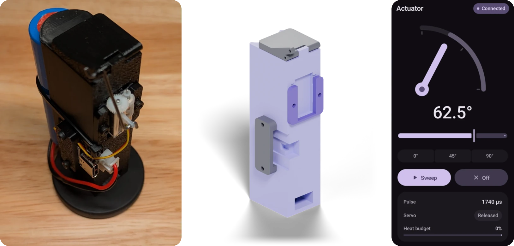

# actuator

A tiny BLE-controlled linear actuator: an AGFRC C1.5CLS 1.5 g linear micro
servo (9 mm stroke, worm drive) on a Seeed XIAO ESP32C6, swinging a 6 mm horn
arm through 90°, driven from an Android phone.

  

More renders are in [`hardware/`](hardware), and more app screenshots in
[`android/`](android).

| | |
|---|---|
| [`firmware/`](firmware) | ESP-IDF 6.0 firmware: servo control with stall protection, NimBLE peripheral with PIN pairing, OTA updates over BLE with rollback, status LED, USB console |
| [`hardware/`](hardware) | Printable parts (STL): body, door, servo and ESP32 brackets |
| [`android/`](android) | Kotlin + Jetpack Compose app (Material 3 Expressive): finds, pairs and drives the actuator |

The BLE protocol (UUIDs, value layouts, error codes) is specified in
[`firmware/main/ble.h`](firmware/main/ble.h).

## Quick start

1. Print the parts in [`hardware/`](hardware) and assemble.
2. Wire the servo: red to 5V, brown to GND, orange to D10 (GPIO18). See
   [firmware/README.md](firmware/README.md#wiring) for the pin-order catch.
3. Pick a pairing PIN: `cp firmware/sdkconfig.defaults.local.example
   firmware/sdkconfig.defaults.local` and fill in six digits.
4. Flash once over USB: `cd firmware && idf.py build flash`. After that,
   `tools/ota-push` updates it over BLE.
5. Build and install the app ([android/README.md](android/README.md)), open
   it, and enter the PIN when Android asks.

## License

[MIT](LICENSE)
