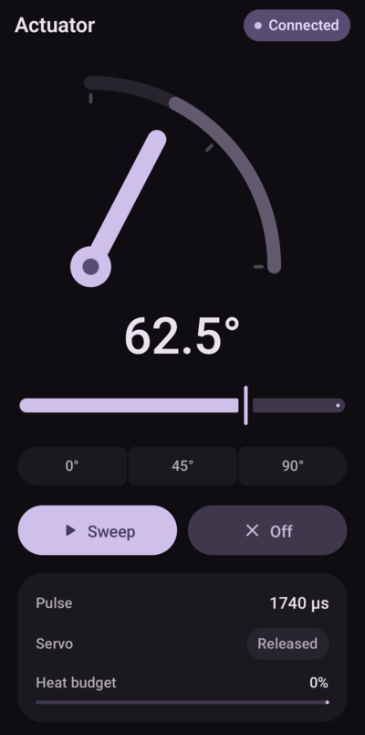
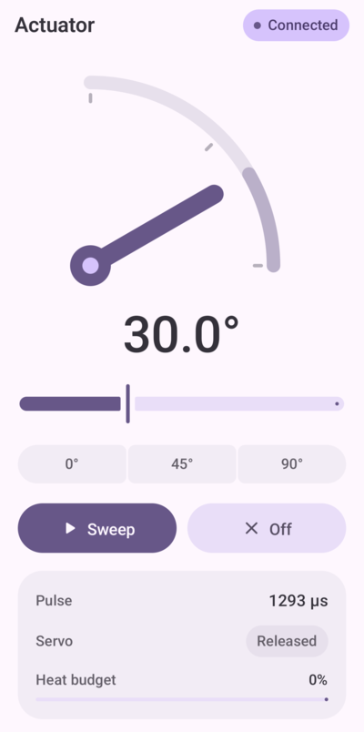
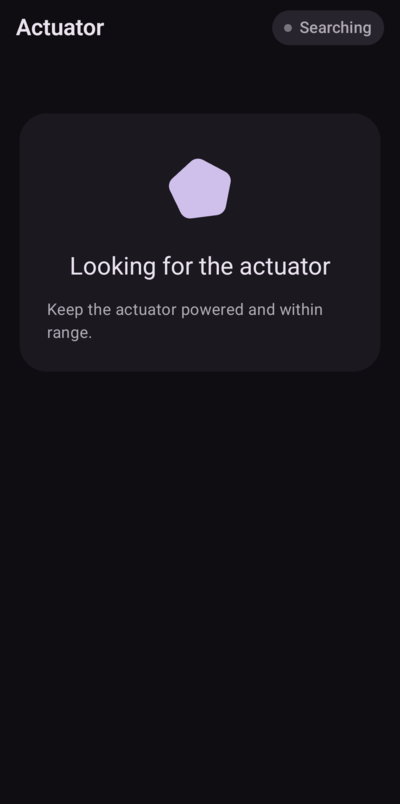
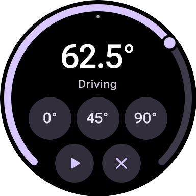
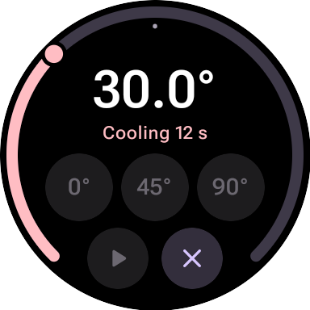
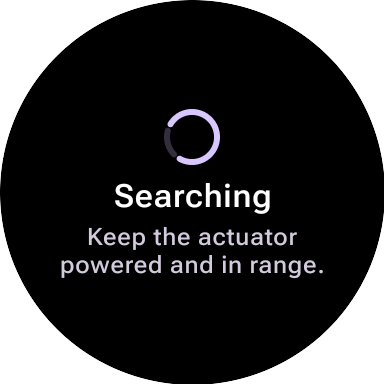

# actuator (Android)

Drives the linear-servo actuator over BLE, from a phone or a Wear OS watch.
Firmware, protocol and wiring live in [`../firmware`](../firmware) (see its
README, section BLE).

Kotlin + Jetpack Compose, **Material 3 Expressive** (material3 1.5.0-rc01:
button groups, loading indicator, expressive motion), Material You colours from
the wallpaper. minSdk 33, compileSdk/target 37. Built for and tested on a Pixel
8a (Android 17).

<p align="center">
  
  
  
</p>

Colours come from the phone's wallpaper (Material You), so yours will differ.

| Module | File | |
|---|---|---|
| `shared/` | `ActuatorLink.kt` | BLE: scan, pair, connect, GATT op queue, status decoding. Also holds the launcher icon and the Bluetooth permissions. |
| `app/` | `ActuatorScreen.kt` | The phone screen: controls, status card, connection states |
| | `HornGauge.kt` | The animated horn drawing |
| | `MainActivity.kt` | Theme, permissions, starts/stops the link with the activity |
| `wear/` | `WatchScreen.kt` | The watch screen: bezel gauge, crown input, presets, connection states |
| | `MainActivity.kt` | The same lifecycle as the phone's |
| | `DemoActivity.kt` | Debug builds only: the dial on a simulated actuator |

## Use

Open the app. It scans for the actuator's service UUID and connects. The first
time, Android asks for the 6-digit pairing PIN, which is
`CONFIG_ACTUATOR_BLE_PIN` in the firmware's `sdkconfig.defaults.local`. After
that the phone is bonded and connects silently.

- **Slider:** horn angle 0-90° in 0.5° steps. Only the newest position is sent,
  so a fast drag never queues up.
- **0° / 45° / 90°, Sweep, Off:** sent with write responses, so the firmware
  can refuse them. Refusals show as a message: cooling down (heat lockout) or
  busy (sweep or update running).
- **Status card:** live from notifications: pulse width, driving/released/
  sweeping, heat budget, and a cooldown banner during a heat lockout. Sliders and
  presets lock while sweeping or cooling; Off always works.

The app holds the connection only while it is in the foreground. The firmware
takes one connection at a time, so leaving the app frees it for the desktop
update tool.

To re-pair: forget the device in Android's Bluetooth settings, run `ble forget`
on the firmware console (or just re-pair: the firmware drops a stale bond when
the phone asks to pair again), then reopen the app.

## Watch

<p align="center">
  
  
  
</p>

A standalone Wear OS app (Wear Compose Material 3, minSdk 33 = Wear OS 4). The
watch talks to the actuator itself, with the same `ActuatorLink` as the phone,
so the phone doesn't have to be nearby or even own the app. Tested on a Pixel
Watch 3 (Wear OS 7).

It pairs separately: the first time, the watch asks for the same 6-digit PIN.
Start typing as soon as the keypad appears. Wear OS cancels the pairing if the
screen goes to sleep first, and then the app shows "Pairing failed" with a
button to try again.

- **Crown:** turns the horn in 0.5° steps, with a tick every 5°. One screen
  height of scroll is 45°. Like the slider, only the newest position is sent.
- **0° / 45° / 90°, Sweep (▶), Off (✕):** as on the phone. A refusal (cooling
  down, busy) covers the screen for a few seconds; tap to dismiss.
- **Gauge:** the bezel arc is the horn angle, 0° at the bottom left round to
  90° at the bottom right. Under the angle is the servo state, plus the heat
  budget once it passes 50%. During a heat lockout the gauge turns red and the
  line counts down.

The firmware takes one connection, so the watch and the phone can't both be
connected. Each app lets go when it leaves the screen; if the watch says "Not
found", close the app on the phone.

To try the dial without an actuator (an emulator has no real Bluetooth), debug
builds include a simulated one:

```sh
adb shell am start -n us.lastra.actuator/.wear.DemoActivity
adb shell am start -n us.lastra.actuator/.wear.DemoActivity --ei angle 300 --ei cooldown 12
```

## Build and install

Toolchain: AGP 9.5.1 (it compiles Kotlin itself; KGP 2.4.21 on the buildscript
classpath, matched by the Compose compiler plugin), Gradle 9.9.0. Gradle needs
`JAVA_HOME` at JDK 17 or newer. The Android SDK needs `platforms/android-37.0`
and `build-tools/37.0.0`, found through `local.properties` (`sdk.dir=...`, which
Android Studio writes) or `ANDROID_HOME`. material3 1.5 is what
forces compileSdk 37 and AGP 9.1+.

```sh
./gradlew assembleDebug
adb install -r app/build/outputs/apk/debug/app-debug.apk
# optional: skip the Nearby devices permission dialog
adb shell pm grant us.lastra.actuator android.permission.BLUETOOTH_SCAN
adb shell pm grant us.lastra.actuator android.permission.BLUETOOTH_CONNECT
```

The watch app is the `wear` module. Turn on Developer options and Wireless
debugging on the watch (Settings, System, About, tap Build number seven times),
then pair and install over Wi-Fi:

```sh
./gradlew :wear:assembleDebug
adb pair <watch-ip>:<pairing-port>     # code shown under "Pair new device"
adb connect <watch-ip>:<port>          # port shown on the Wireless debugging screen
adb -s <watch-ip>:<port> install -r wear/build/outputs/apk/debug/wear-debug.apk
```
