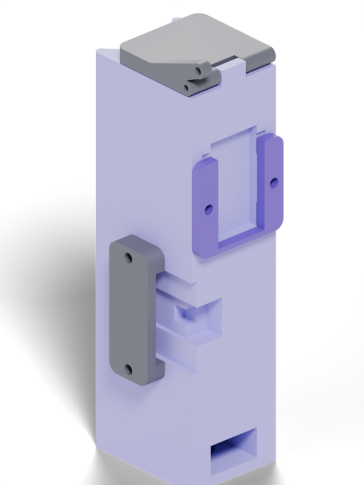
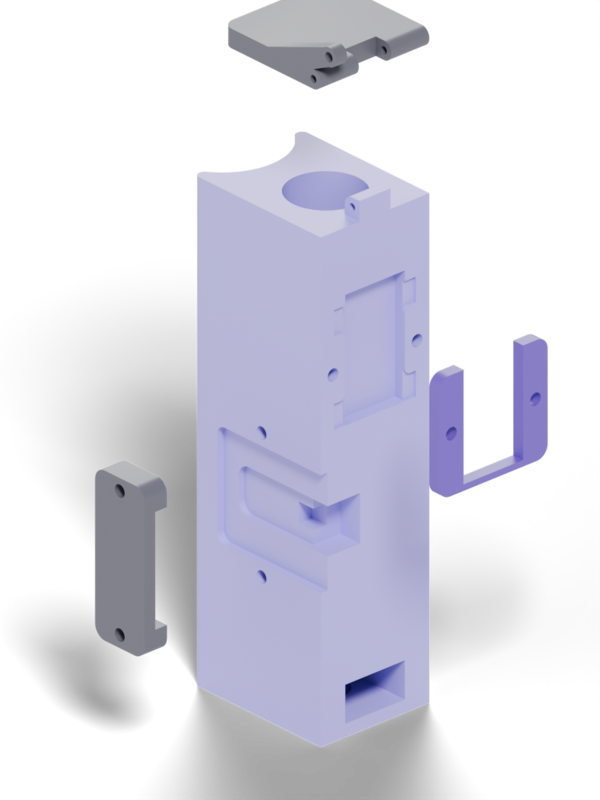
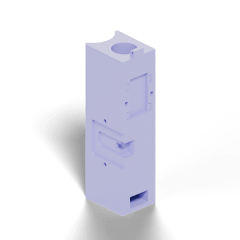
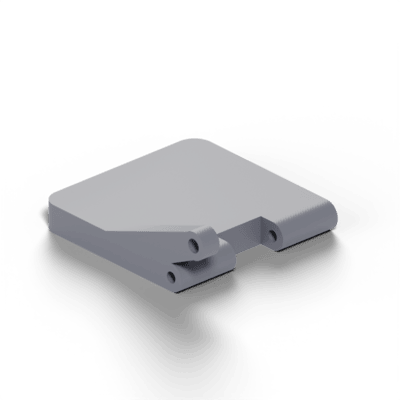
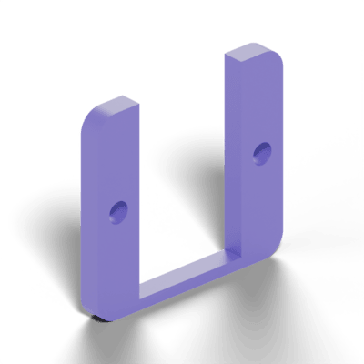
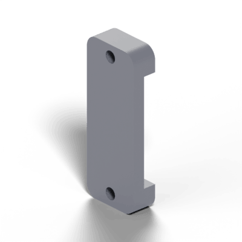

# hardware

Printable parts, exported from Onshape as STL in millimetres. GitHub shows
each one in a 3D viewer when you open the file.

  
  

| | Part | Size (mm) | What it is |
|---|---|---|---|
|  | [`body.stl`](body.stl) | 20 × 25.7 × 81 | Main body |
|  | [`door.stl`](door.stl) | 20 × 23.1 × 7.5 | Hinged door the horn swings through 90° |
|  | [`servo-bracket.stl`](servo-bracket.stl) | 20 × 2 × 18.5 | U bracket that holds the servo |
|  | [`esp32-bracket.stl`](esp32-bracket.stl) | 4.2 × 10 × 26 | Bracket that holds the XIAO ESP32C6 |

The STLs keep their positions from the Onshape Part Studio, so importing all
four unmoved gives the assembly. The renders come from `render.py`
(Blender, Cycles): `blender -b -P render.py -- renders .` from this folder.

The horn arm is 6 mm from its pivot, which the firmware's angle mapping
assumes (`firmware/main/servo.h`). If you change the arm length, recalibrate
`SERVO_MIN_US`/`SERVO_MAX_US` (see [firmware/README.md](../firmware/README.md#linkage)).
